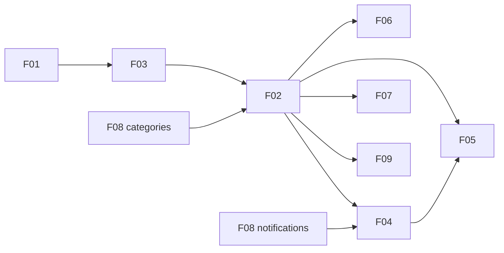

# Kinbook — Feature Breakdown

This folder breaks the product requirements document [`../plan/accounting-app-prd.md`](../plan/accounting-app-prd.md) into implementable features for the **Python + Streamlit** build described in [`../tech/`](../tech/README.md).

## Feature index

| ID | Feature | PRD section | Requirement IDs | Main page(s) | MVP? |
|----|---------|-------------|-----------------|--------------|------|
| [F01](F01-onboarding-identity.md) | Onboarding & identity | 6.1 | ON-1 … ON-5 | sign-in, onboarding | ✅ |
| [F02](F02-transactions.md) | Recording transactions | 6.2 | TX-1 … TX-7, TX-9 … TX-12 | add, transactions | ✅ |
| [F03](F03-accounts.md) | Accounts | 6.3 | AC-1 … AC-5 | accounts | ✅ |
| [F04](F04-family-shared-ledgers.md) | Family & shared ledgers | 6.4 | FM-1 … FM-10 | family | ✅ |
| [F05](F05-budgets-goals.md) | Budgets & goals | 6.5 | BG-1 … BG-5 | budgets, home | ✅ |
| [F06](F06-reports-insights.md) | Reports & insights | 6.6 | RP-1 … RP-7 | reports, home | ✅ |
| [F07](F07-data-management.md) | Data management | 6.7 | DM-1 … DM-6 | settings › data | ✅ |
| [F08](F08-settings-categories-notifications.md) | Settings, categories & notifications | 6.8 (+ FM-7) | ST-1 … ST-4 | settings, notification bell | ✅ |
| [F09](F09-einvoice-import.md) | Taiwan e-invoice import | 6.2 | TX-8 | settings › e-invoice, inbox | P1 |

## Delivery order

| Milestone | Scope (P0 unless noted) | Exit criteria |
|-----------|-------------------------|---------------|
| M1 — Walking skeleton (2 wk) | Repo, CI, docker compose, Alembic baseline, sign-in (`st.login`), `SignInUser`, empty home page | Sign in → see personal ledger; CI green with import-linter and query-budget harness |
| M2 — Personal bookkeeping (4 wk) | F03 accounts, F08 categories, F02 quick add / list / edit / search / trash, recurring rules | A single user can run a month of personal bookkeeping |
| M3 — Family (3 wk) | F04 groups, invitations, shared ledgers, splits, balances, settlements, F08 notification center | Two users share a ledger and settle up |
| M4 — Insight (2 wk) | F05 budgets and alerts, F06 overview / breakdown / trend, home dashboard | Budget alert email arrives; reports meet query budgets |
| M5 — Hardening (2 wk) | F07 export / deletion, F01 demo mode, security review, Playwright golden paths, load test | Beta release |
| M6 — v1.x | P1 items, led by F09 e-invoice | — |

## Status legend used in feature files

| Tag | Meaning |
|-----|---------|
| **Keep** | Implemented as described in the PRD |
| **Adapted** | Implemented differently because of the web/Streamlit platform. The replacement is described. |
| **Dropped** | Not feasible on the chosen platform. Revisit if native clients are built. |

## Platform adaptations (Streamlit)

| PRD ID | PRD requirement | Status | Streamlit implementation |
|--------|-----------------|--------|--------------------------|
| Platforms | Native Android & iOS | **Adapted** | Responsive web app (`layout="centered"`), tested on mobile Chrome and Safari viewports. |
| ON-1 | Log without sign-up (local mode) | **Adapted** | Demo mode with sample data (`?demo=1`), not persisted. Real use requires a one-tap OIDC sign-in. |
| ON-3 | Apple / Google / LINE / email sign-in | **Keep** (via broker) | `st.login()` against an OIDC broker that federates all four. |
| ON-5 | PIN / biometric app lock | **Adapted** | Idle timeout (30 min) + IdP session; passkeys and MFA via the broker. |
| TX-7 | Home-screen widget, quick tile | **Adapted** | Native widgets are impossible; instead: bookmarkable `/add` page; guide users through "Add to Home Screen". |
| TX-9 | Receipt OCR | Keep (P2) | `st.camera_input` / `st.file_uploader` → OCR service adapter. |
| TX-10 | Voice entry | Keep (P2) | `st.audio_input` → speech-to-text adapter → parser. |
| FM-7 | Push notifications | **Adapted** | In-app notification center (polling fragment) + opt-in email. |
| FM-10 | Conflict-safe concurrent edits (field-level last-writer-wins) | **Adapted** | Optimistic locking with a conflict dialog + full edit history. |
| DM-1 | Offline-first | **Dropped** | Online-only. Unsaved quick-add input survives reruns in session state. |
| DM-2 | Cloud sync across devices | **Keep** (inherent) | Server is the single source of truth. |
| DM-6 | Local encrypted backup for users without accounts | **Adapted** | Full JSON export (F07); no account-less persistence. |
| ST-2 | Dark mode, system font scale | **Adapted** | User theme preference + Streamlit theme; browser zoom / OS text size. |
| NFR Testability | Appium accessibility IDs | **Adapted** | Stable widget `key`s → `st-key-<key>` CSS classes for Playwright; Streamlit `AppTest` for page tests. |
| §10 Business model | In-app subscription | **Adapted** | `family_groups.plan` entitlement flag; payment integration (e.g. Stripe Checkout link) is a separate later feature. |

## Cross-cutting acceptance rules (apply to every feature)

1. Every page renders within its **query budget** ([tech/06](../tech/06-query-performance.md#63-query-budgets-contract)). A budget is part of the feature's definition of done.
2. Every interactive widget has a stable `key` named `<page>.<element>` (e.g. `add.amount`).
3. All user-visible strings are in `i18n/en.toml` and `i18n/zh_TW.toml`.
4. Money is entered and displayed through `money_input` / `format_money` only (TWD shows no decimals).
5. Authorization is enforced in the application layer, and each feature adds rows to the authorization test matrix.
