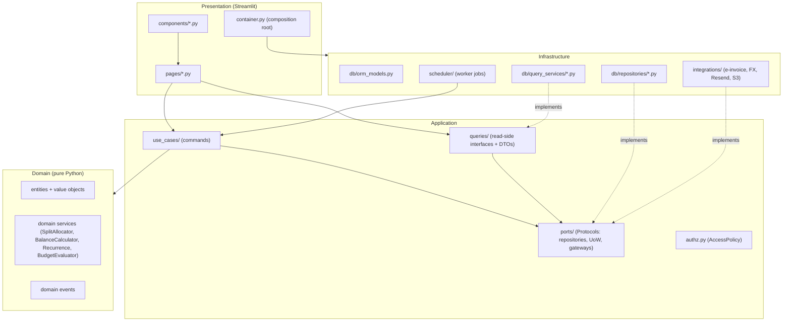

# 01 — Architecture

## 1. Goals that drive the architecture

| Driver | Consequence |
|--------|-------------|
| Money correctness | Pure, framework-free domain layer with exhaustive unit tests; integer minor units only. |
| Family sharing with strict privacy | One central authorization policy in the application layer, checked by every use case; never in the UI. |
| Database performance (no N+1) | Separate write model (repositories that load aggregates) from read model (query services that return flat DTOs in one SQL statement). ORM lazy loading is disabled. |
| Streamlit's rerun model | UI code is thin and stateless. The whole script reruns on each interaction, so all logic lives in layers that do not depend on Streamlit. |
| Future native clients | Domain and application layers have no Streamlit imports and can sit behind a REST adapter unchanged. |

## 2. Tech stack

| Concern | Choice | Notes |
|---------|--------|-------|
| Language | Python 3.14 | Type hints everywhere, `mypy --strict`. Uses stdlib `uuid.uuid7()` (new in 3.14) for primary keys, and deferred annotation evaluation (PEP 649). Pin with `.python-version` (`3.14`) and `requires-python = ">=3.14"`. Before M1, verify that wheels for every dependency are published for 3.14 (Streamlit, psycopg, pydantic-core, pandas). |
| UI | Streamlit ≥ 1.50 | `st.navigation` / `st.Page` multipage, `st.fragment` for partial reruns, `st.dialog`, `st.pills` / `st.segmented_control`, native `st.login()` OIDC. |
| Charts | Plotly (`st.plotly_chart`) | Donut, bar, line, and calendar heatmap. |
| ORM / SQL | SQLAlchemy 2.0 (typed `Mapped[]`, `select()` style) | `lazy="raise"` on every relationship. |
| Migrations | Alembic | One migration per PR; autogenerate output is always reviewed by hand. |
| Database — dev | SQLite 3 (file `var/kinbook-dev.db`, WAL mode) | Zero-setup local development: `uv run streamlit run …` works without Docker. Selected with `KINBOOK_DATABASE_URL=sqlite:///var/kinbook-dev.db` (the default in `local`). See [§ 2.1](#21-sqlite-in-development) for limits. |
| Database — CI / staging / prod | PostgreSQL 16 | Partial and covering indexes, `pg_trgm` for search, `pg_stat_statements`. Integration tests and query-budget tests **always** run on PostgreSQL (testcontainers). |
| DB driver | stdlib `sqlite3` (dev); psycopg 3 (PostgreSQL) | Connection pool through SQLAlchemy `QueuePool` on PostgreSQL. |
| Validation / DTOs | Pydantic v2 | Command and query DTOs at the application boundary; settings via `pydantic-settings`. |
| Background jobs | APScheduler 3 in a separate **worker** process | Recurring transactions, outbox dispatch, budget alerts, e-invoice sync, FX rates, purges. |
| Object storage | S3-compatible (MinIO locally) via `boto3` | Receipt photos and export files. |
| Identity | OIDC broker (Keycloak self-hosted, or Auth0) behind `st.login()` | Federates Google, Apple, LINE, and email one-time-code sign-in. |
| Email | [Resend](https://resend.com) via the official `resend` Python SDK | Invitations, budget alerts, monthly summary, logging reminders. Uses the batch endpoint (up to 100 emails per call) for worker fan-out. `RESEND_API_KEY` comes from the secret manager. In `local`, a `ConsoleEmailSender` logs emails instead of sending them. Delivery webhooks (bounces and complaints) are P1. |
| Data export | pandas + openpyxl | CSV and XLSX. |
| Package & environment manager | **uv** (pip is not used) | `uv sync` installs from the committed `uv.lock`, `uv add` / `uv remove` manage dependencies, and `uv run` executes tools and the app. Dev tools live in `[dependency-groups] dev`. Docker images install with `uv sync --frozen --no-dev`. CI uses `astral-sh/setup-uv` with caching. |
| Tooling | Ruff (lint + format), mypy, pre-commit | All invoked through `uv run`. |
| Tests | pytest, pytest-cov, Hypothesis, testcontainers (PostgreSQL), Streamlit `AppTest`, Playwright | See [02 § Testing](02-system-design.md#9-testing-strategy). |
| Observability | structlog (JSON logs), Sentry, Prometheus metrics from the worker | |
| Deployment | Docker images, docker compose (staging and optional PostgreSQL-parity dev), any container platform (prod) | Reverse proxy with WebSocket support and sticky sessions. |

### 2.1 SQLite in development

Local development defaults to SQLite so a developer can start with `uv sync && uv run streamlit run src/kinbook/presentation/streamlit_app.py` and no Docker. **PostgreSQL remains the production database and the reference for correctness and performance.** Rules:

1. **All tests that touch SQL run on PostgreSQL**: integration tests, query-budget tests, and migration tests (testcontainers). Only unit tests and `AppTest` UI tests, which use in-memory fakes, run without a database.
2. **Migrations run on both dialects.** Alembic uses `render_as_batch=True` for SQLite `ALTER` support. PostgreSQL-only DDL is wrapped in `if op.get_context().dialect.name == "postgresql":`.
3. **Dialect differences are isolated** in `infrastructure/db/dialect.py` and in clearly marked query-service variants. Domain, application, and presentation code never checks the dialect.
4. **Dev data is disposable.** There is no SQLite → PostgreSQL data migration. Seed data comes from `uv run kinbook-seed`.
5. For PostgreSQL parity on a laptop, `docker compose --profile postgres up` runs the same stack as staging and sets `KINBOOK_DATABASE_URL` to PostgreSQL.

| PostgreSQL feature used in [04](04-database-schema.md) / [06](06-query-performance.md) | SQLite dev behavior |
|---------------------------------------------|---------------------|
| `uuid`, `jsonb`, `smallint[]`, `citext`, `bytea` | SQLAlchemy portable types: `Uuid`, `JSON().with_variant(JSONB, "postgresql")`, `JSON` for arrays, `COLLATE NOCASE` for email, `LargeBinary` |
| `timestamptz` | Stored as UTC ISO text. The app always writes aware UTC datetimes, and the mapper re-attaches `UTC` on read. |
| `numeric(18,8)` FX rates | Stored as text through a `DecimalAsText` type decorator to avoid float rounding |
| Partial indexes, `CHECK` constraints, `FILTER (WHERE …)`, CTEs | Supported natively |
| Covering indexes (`INCLUDE`) | Created as plain indexes |
| `UNIQUE NULLS NOT DISTINCT` | Unique expression index on `coalesce(col, '')` |
| `pg_trgm` search | Falls back to `lower(note \|\| ' ' \|\| merchant) LIKE :pattern` |
| `GROUPING SETS` / `ROLLUP` (reports, budgets) | `UNION ALL` variant of the same query (still 1 statement) |
| `LEFT JOIN LATERAL` (account balances) | Correlated scalar sub-selects (still 1 statement) |
| `generate_series` (trend, net-worth series) | Recursive CTE |
| `UPDATE ledgers … RETURNING` row lock | `BEGIN IMMEDIATE` (database-level write lock; fine for a single developer) |
| `FOR UPDATE SKIP LOCKED`, advisory lock (worker) | Omitted; a single local worker is assumed |
| `CREATE INDEX CONCURRENTLY`, RLS, `pg_stat_statements` | Skipped |

The query-count guard ([06 § 6.4](06-query-performance.md#64-runtime-guard)) also runs on SQLite. N+1 regressions are therefore visible during local development, but query plans and timings are judged only on PostgreSQL.

### 2.2 Everyday commands (uv)

| Task | Command |
|------|---------|
| Install / sync environment | `uv sync` (creates `.venv` from `uv.lock`; installs Python 3.14 if missing) |
| Add / remove a dependency | `uv add <pkg>` · `uv add --dev <pkg>` · `uv remove <pkg>` |
| Upgrade the lockfile | `uv lock --upgrade` (or `--upgrade-package <pkg>`) |
| Run the app | `uv run streamlit run src/kinbook/presentation/streamlit_app.py` |
| Run the worker | `uv run python -m kinbook.infrastructure.scheduler.worker` |
| Migrations | `uv run alembic upgrade head` · `uv run alembic revision --autogenerate -m "…"` |
| Tests | `uv run pytest` · `uv run pytest tests/integration` |
| Lint / format / types | `uv run ruff check --fix` · `uv run ruff format` · `uv run mypy src` |
| Architecture contracts | `uv run lint-imports` |
| Docker build step | `uv sync --frozen --no-dev --no-install-project` then copy source, then `uv sync --frozen --no-dev` |

`pip install` and `requirements.txt` are not used anywhere: not in docs, CI, or Dockerfiles. `uv.lock` is committed and is the single source of resolved versions.

## 3. Clean architecture layers



### 3.1 Dependency rule

Source dependencies point **inward only**: Presentation → Application → Domain. Infrastructure implements interfaces declared in Application.

| Layer | May import | Must never import |
|-------|-----------|-------------------|
| `domain` | Python standard library only | `sqlalchemy`, `streamlit`, `pydantic`, anything in `application` / `infrastructure` / `presentation` |
| `application` | `domain`, `pydantic` | `sqlalchemy`, `streamlit`, `infrastructure`, `presentation` |
| `infrastructure` | `application` (ports), `domain`, third-party libraries | `streamlit`, `presentation` |
| `presentation` | `application` (use cases, query interfaces, DTOs), `streamlit` | `infrastructure` (except `container.py`), `sqlalchemy` |

This is enforced in CI with **import-linter** contracts (`layers` contract plus `forbidden` contracts for `sqlalchemy` and `streamlit`).

### 3.2 Responsibilities

**Domain** — business rules that hold regardless of storage or UI.
- Entities: `User`, `FamilyGroup`, `Ledger`, `Account`, `Category`, `Transaction` (aggregate root that owns `Split`s, tags, attachments), `RecurringRule`, `Budget`, `Goal`, `InvoiceDraft`.
- Value objects: `Money(amount_minor: int, currency: Currency)`, `Currency` (ISO 4217 with exponent), `Percentage`, `SplitSpec`, `Period`, typed IDs (`LedgerId`, `UserId`, …) as `NewType` over `uuid.UUID`.
- Domain services: `SplitAllocator` (largest-remainder allocation; remainder goes to the payer first), `BalanceCalculator` (net per member, minimal settle-up suggestions), `RecurrenceCalculator` (next occurrence dates), `BudgetEvaluator` (threshold crossing).
- Domain events: `TransactionRecorded`, `TransactionUpdated`, `TransactionDeleted`, `SettlementRecorded`, `MemberJoined`, `BudgetThresholdCrossed`.
- Errors: `DomainError` subclasses (`InvalidSplit`, `CurrencyMismatch`, `LedgerArchived`, …).

**Application** — orchestrates one user intention per use case.
- Each use case is a class with a single `__call__(self, actor: UserId, cmd: XCommand) -> XResult`.
- It authorizes the actor through `AccessPolicy`, loads aggregates through repositories, calls domain logic, persists through the **Unit of Work**, bumps the ledger revision, and writes domain events to the outbox, all in one DB transaction.
- Read-side **query interfaces** (`DashboardQueries`, `ReportQueries`, `TransactionQueries`, …) return immutable Pydantic DTOs. They do not return domain entities.
- Ports (`typing.Protocol`): `UnitOfWork`, `*Repository`, `Clock`, `FxRateProvider`, `EInvoiceGateway`, `BlobStorage`, `EmailSender`, `IdGenerator`.

**Infrastructure** — adapters.
- SQLAlchemy ORM models (separate from domain entities; data-mapper style) and explicit mapper functions.
- Repository implementations: aggregate load and save with **declared eager-loading strategies**.
- Query-service implementations: hand-written SQLAlchemy Core `select()` statements with joins and aggregates that produce DTO rows directly.
- Integrations: MOF e-invoice API client, FX rate fetcher, Resend email sender (console sender in `local`), S3 storage.
- Dialect helpers (`db/dialect.py`) for the SQLite-in-dev differences listed in [§ 2.1](#21-sqlite-in-development).
- Worker: APScheduler jobs that call application use cases.

**Presentation** — Streamlit.
- `streamlit_app.py` is the entry point. It handles authentication, builds `st.navigation`, and resolves the current user.
- Pages render DTOs and dispatch commands. They hold no business logic and never touch the DB session.
- `container.py` is the **composition root**. It wires infrastructure into use cases, cached with `st.cache_resource`, so it is built once per process.

## 4. Source tree

```
kinbook/
├── pyproject.toml                # project metadata, [dependency-groups] dev, tool config
├── uv.lock                       # committed lockfile (uv)
├── .python-version               # 3.14
├── alembic.ini
├── var/                          # git-ignored: kinbook-dev.db (SQLite dev database)
├── docker/
│   ├── app.Dockerfile
│   ├── worker.Dockerfile
│   └── compose.yaml
├── src/kinbook/
│   ├── domain/
│   │   ├── money.py              # Money, Currency, allocation helpers
│   │   ├── ids.py
│   │   ├── errors.py
│   │   ├── events.py
│   │   ├── model/
│   │   │   ├── user.py
│   │   │   ├── family.py         # FamilyGroup, Membership, Role
│   │   │   ├── ledger.py         # Ledger, LedgerMember, LedgerKind
│   │   │   ├── account.py
│   │   │   ├── category.py
│   │   │   ├── transaction.py    # Transaction aggregate, Split, TransactionType
│   │   │   ├── recurring.py
│   │   │   ├── budget.py
│   │   │   ├── goal.py
│   │   │   └── einvoice.py
│   │   └── services/
│   │       ├── split_allocator.py
│   │       ├── balance_calculator.py
│   │       ├── recurrence.py
│   │       └── budget_evaluator.py
│   ├── application/
│   │   ├── authz.py              # AccessPolicy
│   │   ├── ports/
│   │   │   ├── uow.py
│   │   │   ├── repositories.py
│   │   │   └── gateways.py       # Clock, FxRateProvider, EInvoiceGateway, BlobStorage, EmailSender
│   │   ├── dto/                  # Pydantic commands, results, read DTOs
│   │   ├── use_cases/
│   │   │   ├── identity/  transactions/  accounts/  family/
│   │   │   ├── budgets/   reports/       data/      settings/   einvoice/
│   │   └── queries/              # Protocols for read side
│   ├── infrastructure/
│   │   ├── config.py             # pydantic-settings
│   │   ├── db/
│   │   │   ├── engine.py         # builds SQLite (dev) or PostgreSQL engine from KINBOOK_DATABASE_URL
│   │   │   ├── dialect.py        # portable types + dialect-specific query helpers
│   │   │   ├── orm_models.py
│   │   │   ├── mappers.py
│   │   │   ├── uow.py
│   │   │   ├── repositories/
│   │   │   └── query_services/
│   │   ├── integrations/
│   │   │   ├── einvoice_mof.py
│   │   │   ├── fx_rates.py
│   │   │   ├── resend_email.py   # ResendEmailSender (staging / prod)
│   │   │   ├── console_email.py  # ConsoleEmailSender (local)
│   │   │   └── s3_storage.py
│   │   └── scheduler/
│   │       ├── worker.py
│   │       └── jobs.py
│   └── presentation/
│       ├── streamlit_app.py
│       ├── container.py
│       ├── state.py              # typed wrappers around st.session_state
│       ├── i18n/  (en.toml, zh_TW.toml, loader.py)
│       ├── pages/
│       │   ├── home.py  add.py  transactions.py  accounts.py
│       │   ├── family.py  budgets.py  reports.py  inbox.py  settings.py
│       └── components/
│           ├── quick_add.py  money_input.py  tx_list.py
│           ├── charts.py  ledger_switcher.py  notifications.py
├── migrations/                   # Alembic versions
└── tests/
    ├── unit/          # domain + application with in-memory fakes
    ├── integration/   # repositories / query services on real PostgreSQL
    ├── ui/            # Streamlit AppTest
    └── e2e/           # Playwright against docker compose
```

## 5. Key design patterns

| Pattern | Where | Why |
|---------|-------|-----|
| Unit of Work | `application/ports/uow.py`, `infrastructure/db/uow.py` | One DB transaction per use case. Commit is explicit, and rollback happens on any exception. |
| Repository (aggregate-oriented) | Write side | Loads a complete aggregate with a fixed eager-load plan. No lazy loading. |
| CQRS-lite (separate read model) | `queries/` + `query_services/` | Read screens get flat DTOs from one SQL statement each. This is the main defense against N+1. |
| Transactional outbox | `outbox_events` table | Notifications and alerts are dispatched reliably by the worker after commit. |
| Optimistic concurrency | `transactions.version` | Safe concurrent edits by family members; conflicts are surfaced to the user. |
| Ledger revision counter | `ledgers.revision` | Cheap cache-invalidation key for `st.cache_data` that every family member's session observes. |
| Composition root + constructor injection | `presentation/container.py` | No service locators. Tests swap adapters with fakes. |

## 6. Architecture decision records (summary)

| ADR | Decision | Alternatives considered | Reason |
|-----|----------|------------------------|--------|
| ADR-001 | Python + Streamlit responsive web app | Native Kotlin/Swift; Flutter; FastAPI + React | Mandated stack. Fastest path to a working MVP for a Python team. Trade-off: online-only, limited mobile UX (see [features README](../features/README.md#platform-adaptations-streamlit)). |
| ADR-002 | Streamlit calls the application layer **in-process**; no internal REST API for the MVP | Streamlit → REST → backend | An extra network hop and serialization layer add latency and code with no benefit while Streamlit is the only client. The application-layer API is already a clean boundary, and REST can be added later without touching the core. |
| ADR-003 | PostgreSQL for CI, staging, and prod; **SQLite for local development** | PostgreSQL everywhere; SQLite everywhere | Production needs concurrent multi-user writes, row locks for the ledger revision, covering indexes, and trigram search, which only PostgreSQL provides here. SQLite in dev removes setup friction. The cost is a small set of dialect variants ([§ 2.1](#21-sqlite-in-development)), contained by running every SQL-touching test on PostgreSQL. |
| ADR-004 | Separate ORM models from domain entities (data mapper) | ORM models as entities; imperative mapping | Keeps the domain free of SQLAlchemy and keeps lazy-loading surprises out of domain code. |
| ADR-005 | CQRS-lite: query services bypass repositories and domain objects | Building read screens from aggregates | Aggregates are for invariants, not lists. One SQL statement per screen section makes N+1 structurally impossible on the read side. |
| ADR-006 | OIDC broker behind `st.login()` | Direct Google + LINE in `secrets.toml`; custom password auth | `st.login()` supports OIDC providers. A broker adds Apple and email one-time codes, which do not fit `st.login()` directly, and keeps the app config to one provider. No passwords are stored by Kinbook. |
| ADR-007 | Separate worker process with APScheduler and a PostgreSQL advisory lock | Threads inside Streamlit; Celery + Redis | Streamlit processes are not suitable for background work. Celery is overkill at this scale. The advisory lock guarantees a single active scheduler. |
| ADR-008 | Server is the single source of truth; optimistic locking instead of client-side merge | Per-field last-writer-wins sync (PRD FM-10) | There is no offline client, so there is nothing to merge. A version check gives a clearer conflict experience, and the audit history still satisfies FM-10. |
| ADR-009 | Resend for transactional email | Generic SMTP; Amazon SES; SendGrid | Simple HTTP API and Python SDK, batch sending, and domain verification (SPF/DKIM) handled in its dashboard. It sits behind the `EmailSender` port, so switching providers changes one adapter. |
| ADR-010 | uv as the only package and environment manager | pip + venv + requirements.txt; Poetry | One fast tool for the Python version, virtualenv, dependency resolution, and the lockfile. Reproducible installs via `uv.lock` in dev, CI, and Docker. |
| ADR-011 | Python 3.14 | 3.12 / 3.13 | Stdlib `uuid.uuid7()` removes a third-party dependency for time-ordered keys. Newer typing features and performance. Risk: dependency wheel availability, checked before M1. |
