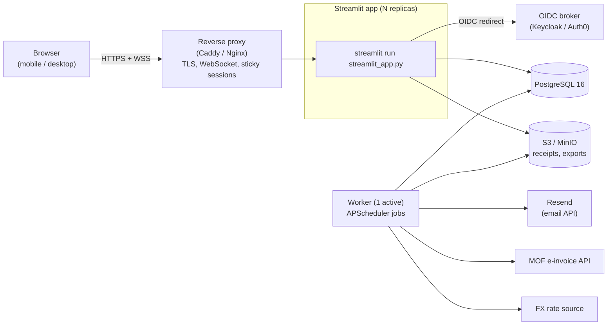
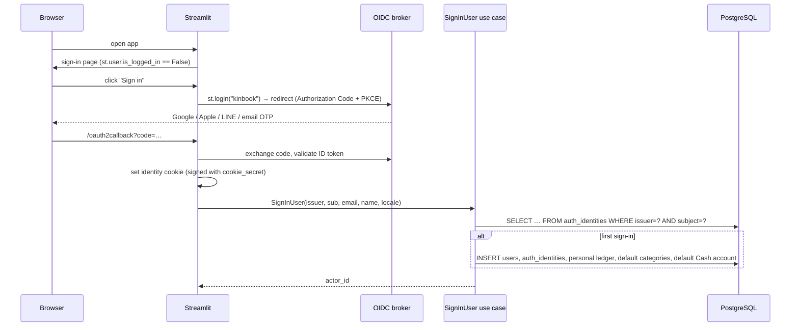

# 02 — System Design

## 1. Runtime components



| Component | Process | Scaling | State |
|-----------|---------|---------|-------|
| Streamlit app | `uv run streamlit run src/kinbook/presentation/streamlit_app.py` | Horizontal. Each replica holds WebSocket sessions, so the proxy must use **sticky sessions** (cookie affinity). | Session state is in memory per session and is ephemeral. All durable state is in PostgreSQL. |
| Worker | `uv run python -m kinbook.infrastructure.scheduler.worker` | One active instance. A standby may run; it takes over when it acquires `pg_try_advisory_lock(7001)`. | None. |
| PostgreSQL | Managed service in prod; container in CI and staging (SQLite replaces it in `local`) | Vertical, plus a read replica if reports grow (not needed for MVP) | Source of truth |
| Object storage | S3 / MinIO | Managed | Receipts (private bucket), exports (expire after 24 h) |
| OIDC broker | Keycloak container or Auth0 SaaS | Managed | Identities, federated logins |

### Environments

| Env | Purpose | Infra |
|-----|---------|-------|
| `local` | Development | Default: app + worker via `uv run` on **SQLite** (`var/kinbook-dev.db`), `ConsoleEmailSender`, local-disk blob storage, Keycloak dev container for sign-in. Optional `docker compose --profile postgres up` for PostgreSQL + MinIO parity ([01 § 2.1](01-architecture.md#21-sqlite-in-development)). |
| `ci` | Tests | testcontainers PostgreSQL for integration tests; full compose stack for Playwright |
| `staging` | Pre-release, beta households | Same images as prod, smaller sizing |
| `prod` | Live | 2+ app replicas, 1 worker (+1 standby), managed PostgreSQL with point-in-time recovery |

## 2. Request lifecycle in Streamlit

Streamlit reruns the page script from top to bottom on every widget interaction. Kinbook keeps each rerun cheap and predictable:

1. **Bootstrap (every rerun)**
   - `container = get_container()`. This is cached with `st.cache_resource`: one engine, connection pool, and set of use cases per process.
   - Authentication guard: if `not st.user.is_logged_in`, show the sign-in page and call `st.stop()`.
   - `actor = container.resolve_user(st.user)`. The result is cached in `st.session_state["actor_id"]` after the first rerun, so there is no query per rerun.
2. **Page render**
   - Read DTOs through query services. Cacheable reads go through `cached_query(...)` (see §4).
   - Widgets use stable `key=` values (these are also the selectors for automated UI tests).
3. **User action**
   - Callbacks (`on_click` / `on_change`) or `st.form` submit build a Pydantic **command** and call the use case.
   - On success: show a toast and clear the affected keys. The bumped ledger revision invalidates cached reads automatically.
   - On `DomainError` / `AuthorizationError` / `ConcurrencyConflict`: show a localized `st.error`. Raw exception text is never shown to the user.
4. **Partial reruns.** The quick-add panel, transaction list, and notification bell are `@st.fragment`s, so interacting with them does not rerun the whole page.

### Session state rules

- Store **only primitives and IDs**: `actor_id`, `active_ledger_id`, filter values, the draft quick-add fields. **Never store ORM objects, DB sessions, or DTO lists.**
- All keys are declared in `presentation/state.py` as typed accessors to avoid key-name typos.

## 3. Authentication & identity



- `secrets.toml` contains a single `[auth]` section pointing at the broker (`redirect_uri`, `cookie_secret`, `client_id`, `client_secret`, `server_metadata_url`).
- Session lifetime is governed by the identity cookie and the broker session. The app adds an **idle timeout of 30 minutes** (last-activity timestamp in session state), after which it calls `st.logout()`.
- Passkeys and MFA are configured in the broker, not in the app.
- **Demo mode** (replacement for PRD ON-1): an anonymous visitor can open `/?demo=1`. This creates an in-memory fake container with sample data. Nothing is written to PostgreSQL.

## 4. Caching strategy

| Cache | API | Scope | Key | Invalidation |
|-------|-----|-------|-----|--------------|
| Container, engine, pool | `st.cache_resource` | Process | none | Process restart |
| i18n bundles, default category templates, currency table | `st.cache_resource` | Process | locale | Deploy |
| Read DTOs (dashboard, reports, balances, budget progress) | `st.cache_data(ttl=600, max_entries=5000)` | Process, shared across sessions | `(query_name, ledger_id, ledger_revision, actor_id, params…)` | Automatic. Any write bumps `ledgers.revision`, so the new key misses. |
| FX rates | `st.cache_data(ttl=3600)` | Process | `(base, quote, date)` | TTL |

**Security rule for shared caches:** `st.cache_data` is shared across *all* users of the process, so authorization is checked **before** calling a cached function, never inside it. `actor_id` is part of the key whenever the result depends on visibility (e.g. personal accounts in net worth).

```python
# presentation/caching.py (illustrative)
def dashboard(actor: UserId, ledger_id: LedgerId, month: date) -> DashboardDTO:
    container = get_container()
    container.access.require_ledger_read(actor, ledger_id)      # authz outside cache
    rev = container.ledger_revisions.current(ledger_id)         # 1 indexed PK lookup
    return _dashboard_cached(str(actor), str(ledger_id), rev, month)

@st.cache_data(ttl=600, max_entries=5000, show_spinner=False)
def _dashboard_cached(actor: str, ledger_id: str, rev: int, month: date) -> DashboardDTO:
    return get_container().dashboard_queries.get(UserId(actor), LedgerId(ledger_id), month)
```

## 5. Background worker

| Job | Schedule | Use case | Idempotency |
|-----|----------|----------|-------------|
| Outbox dispatcher | every 10 s | `DispatchOutbox` | `outbox_events.dispatched_at`; `SELECT … FOR UPDATE SKIP LOCKED` |
| Recurring transactions | every 15 min | `RunDueRecurringRules` | `recurring_occurrences (rule_id, occurrence_date)` unique |
| Budget alerts | from outbox events + nightly sweep 21:00 local | `EvaluateBudgetAlerts` | `budget_alert_log (budget_id, period_start, threshold)` unique |
| E-invoice sync | every 6 h per carrier (jittered) | `SyncCarrierInvoices` | `einvoices (carrier_id, invoice_number)` unique |
| FX rates | daily 17:00 Asia/Taipei | `RefreshFxRates` | `fx_rates` PK upsert |
| Monthly summary email | 1st of month 09:00 local | `SendMonthlySummaries` | `notifications (user_id, kind, period)` unique |
| Daily logging reminder | per-user preferred time, batched every 5 min | `SendLoggingReminders` | `notifications` unique per day |
| Trash purge | daily 03:00 | `PurgeTrash` | Deletes `transactions` where `deleted_at < now() - 30 days` |
| Account deletion | daily 03:30 | `PurgeDeletedUsers` | `users.deletion_requested_at < now() - 30 days` |
| Export file expiry | hourly | `ExpireExports` | Deletes S3 objects older than 24 h |

The worker processes work in **batches** (e.g. 500 due recurring rules per tick, loaded with a single query), never one query per item. See [06 § Batch jobs](06-query-performance.md#7-batch-jobs).

## 6. Notifications

There is no OS push in a web app. PRD push notifications map to two channels:

1. **In-app notification center.** This is the `notifications` table, shown by a bell fragment in the header. The fragment uses `@st.fragment(run_every=60)` to poll the unread count with one indexed `COUNT` query.
2. **Email**, opt-in per notification kind (`user_notification_settings`).

All notifications originate from **outbox events** written in the same transaction as the business change. A notification can therefore never exist without its change, and no change loses its notification.

## 7. Security

| Area | Control |
|------|---------|
| Transport | TLS 1.2+ at the proxy, HSTS; WebSocket over WSS only. |
| Authentication | OIDC (Authorization Code + PKCE) through the broker; no passwords stored by Kinbook. |
| Authorization | `AccessPolicy` in the application layer. Every use case and query entry point calls `require_*`. Covered by a parametrized test matrix (role × ledger kind × action). |
| Privacy rule | Personal ledger: only the owner. Shared ledger: only `ledger_members`. Accounts: only the owner, unless shared through `account_shares`. Enforced in SQL `WHERE` clauses in query services as well as in the policy (defense in depth). |
| Defense in depth (P1) | PostgreSQL row-level security on `transactions`, `accounts`, `ledgers` using `SET LOCAL kinbook.actor_id`. |
| Data at rest | Managed PostgreSQL encryption (AES-256); S3 server-side encryption; e-invoice carrier verification codes encrypted at application level (Fernet, key from a secret manager). |
| Secrets | `secrets.toml` / environment variables injected by the platform secret manager; never committed. |
| Input validation | Pydantic commands (amount bounds, string lengths, currency codes); SQLAlchemy bound parameters only. |
| File uploads | `st.file_uploader` / `st.camera_input` limited to JPEG/PNG/HEIC/PDF, ≤ 10 MB; content-type sniffing; EXIF stripped; stored under random keys; served through short-lived pre-signed URLs. |
| XSS | No `unsafe_allow_html=True` with user content. User text is rendered through `st.text` / `st.markdown` with escaping. |
| Rate limiting | Proxy-level per IP; invitation token attempts limited per user. |
| Audit | `transaction_history` for financial edits; structured security logs for sign-in, membership changes, export, and deletion. |
| Compliance | PDPA / GDPR rights: export (DM-3), deletion (DM-5), privacy notice, analytics opt-out. |

## 8. Observability

- **Logging:** structlog JSON with `request_id` (per rerun), `actor_id` (hashed), `use_case`, `duration_ms`, `db_query_count`.
- **Metrics:** use-case latency histogram, DB query count per use case, cache hit ratio, worker job duration and failures, outbox lag.
- **DB:** `pg_stat_statements` enabled; slow-query log for statements over 200 ms; a weekly review of the top-10 statements.
- **Errors:** Sentry in both the app and the worker, with PII scrubbing.
- **Health:** Streamlit `/_stcore/health` for liveness; the worker exposes `/healthz` and `/metrics` on an internal port.

## 9. Testing strategy

| Level | Tooling | Scope | Gate |
|-------|---------|-------|------|
| Unit | pytest + Hypothesis | Domain (money, splits, balances, recurrence, budgets) and application use cases with in-memory fakes | 95 % line coverage on `domain`, 90 % on `application` |
| Integration | pytest + testcontainers PostgreSQL | Repositories, query services, migrations, **query-count budgets** | Every query service has a query-budget test ([06](06-query-performance.md#6-enforcement)) |
| UI | `streamlit.testing.v1.AppTest` | Each page renders with fake container; widget interactions dispatch the right commands | All pages |
| End-to-end | Playwright (Chromium + mobile WebKit viewport) | Golden paths: sign-in (test IdP), quick add, shared expense + settle up, budget alert, export | Runs on every merge to `main` |
| Architecture | import-linter | Layer dependency contracts | Blocking |
| Static | Ruff, mypy `--strict` | All code | Blocking |
| Performance | Locust (or k6) against staging | 200 concurrent sessions; p95 page render < 800 ms | Before each release |

**Selectors for UI automation:** every interactive widget gets a stable `key` (e.g. `quick_add.amount`, `quick_add.save`). Streamlit adds an `st-key-<key>` CSS class to keyed elements, and Playwright targets that class. This replaces the Appium accessibility-ID requirement in the PRD.

## 10. Non-functional targets (web adaptation of PRD §8)

| PRD target | Web target |
|------------|------------|
| Cold start ≤ 2 s | First meaningful paint ≤ 2.5 s on 4G mid-range phone; subsequent page switches ≤ 800 ms p95 |
| Quick-add opens ≤ 300 ms | Quick-add fragment interactive ≤ 300 ms after navigation (no DB writes before save) |
| 10,000-transaction list at 60 fps | Keyset-paginated list, 50 rows per page, ≤ 150 ms query p95 |
| Sync ≤ 5 s | N/A: writes are immediate; other members see changes on their next rerun or within 60 s via the polling fragment |
| Availability 99.9 % | Same; at least 2 app replicas; managed PostgreSQL with PITR |
