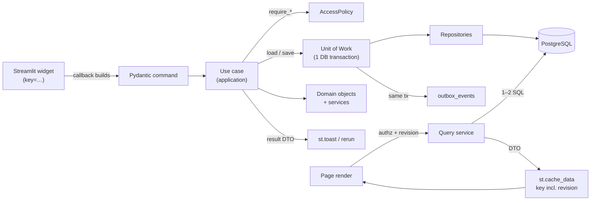
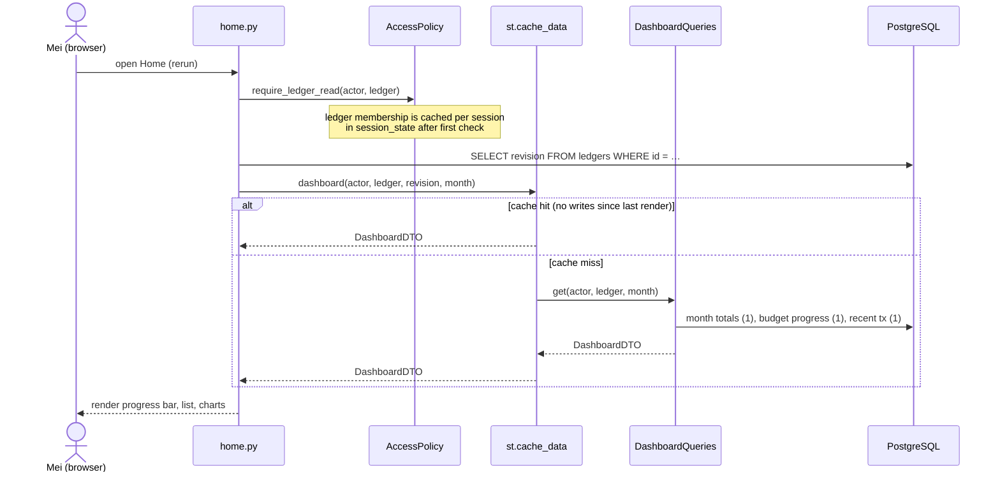
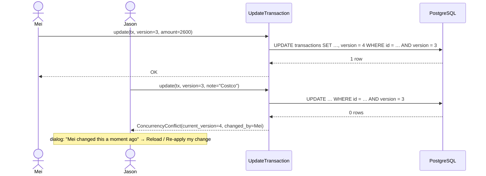
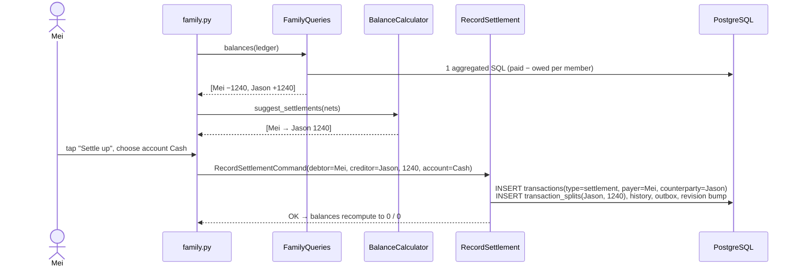
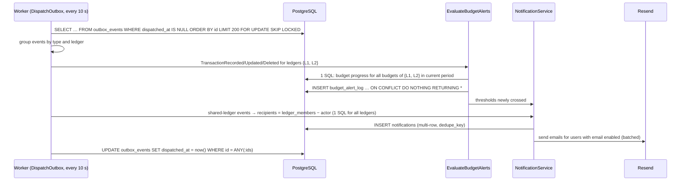
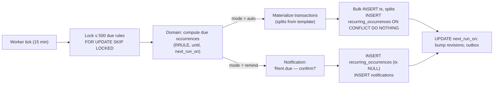
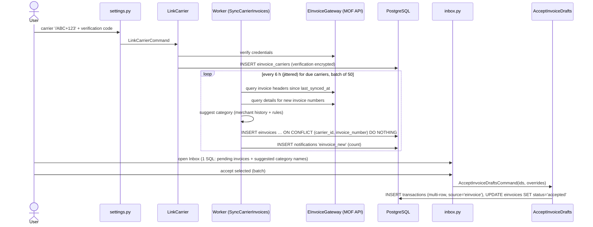

# 03 — Data Flow

## 1. Layered flow (every interaction)



- **Write path:** widget → command → use case → domain → UoW commit (data + revision bump + history + outbox, atomically).
- **Read path:** page → authz check → revision lookup → cached query service → DTO → widgets.
- **Async path:** worker polls the outbox → notifications, emails, budget alerts.

## 2. Record a shared expense (PRD flow 7.2, first half)

```mermaid
sequenceDiagram
    actor J as Jason (browser)
    participant UI as add.py (fragment)
    participant UC as RecordTransaction
    participant AZ as AccessPolicy
    participant D as Domain (Transaction, SplitAllocator)
    participant U as UnitOfWork / repos
    participant DB as PostgreSQL

    J->>UI: amount 2480, Groceries, ledger Household, paid by Jason, split equal
    UI->>UC: RecordTransactionCommand
    UC->>U: begin
    UC->>AZ: require_ledger_write(actor, ledger_id)
    AZ->>DB: SELECT ledger_members WHERE ledger_id, user_id
    UC->>U: ledgers.lock_and_bump(ledger_id)
    U->>DB: UPDATE ledgers SET revision = revision + 1 WHERE id = … RETURNING revision, currency
    UC->>U: validation lookups (account owner, category ledger, members)
    U->>DB: 1 SELECT (accounts ⋈ categories ⋈ ledger_members, filtered by ids)
    UC->>D: Transaction.record(..., SplitSpec.equal(members))
    D-->>UC: Transaction + Splits (1240, 1240) + TransactionRecorded event
    UC->>U: transactions.add(tx)
    U->>DB: INSERT transactions; INSERT transaction_splits (multi-row); INSERT transaction_tags
    U->>DB: INSERT transaction_history (action=create)
    U->>DB: INSERT outbox_events (TransactionRecorded)
    U->>DB: UPSERT quick_add_preferences
    UC->>U: commit
    UC-->>UI: RecordTransactionResult(id, revision)
    UI-->>J: toast "Saved", fragment resets
```

The ledger row lock (`UPDATE … revision + 1`) serializes concurrent writes **within one ledger**. This keeps revision numbers monotonic and costs nothing at family scale.

## 3. Read the dashboard (with cache)



When Jason saves an expense, the revision becomes N+1. Mei's next rerun (her own interaction, or the 60-second polling fragment) misses the cache and sees fresh data.

## 4. Edit with a concurrency conflict



Every successful update writes a `transaction_history` row with a field-level diff, so members can see who changed what (FM-10).

## 5. Settle up (PRD flow 7.2, second half)



## 6. Outbox → notifications & budget alerts



On failure the worker increments `attempts` and `last_error` and leaves the event for retry with exponential backoff. After 10 attempts an alert fires.

## 7. Recurring transactions



The `recurring_occurrences` primary key `(rule_id, occurrence_date)` makes the job safe to rerun after a crash. When a user confirms a "remind" notification, `ConfirmRecurringOccurrence` creates the transaction and fills in `recurring_occurrences.transaction_id`.

## 8. E-invoice import (P1)



## 9. Invitation & join

```mermaid
sequenceDiagram
    actor O as Owner (Mei)
    actor I as Invitee (Jason)
    participant F as family.py
    participant CI as CreateInvitation
    participant AI as AcceptInvitation
    participant DB as PostgreSQL
    O->>F: Invite (role = member)
    F->>CI: command
    CI->>DB: INSERT invitations(token_hash = sha256(token), expires_at = now()+7d)
    CI-->>F: URL https://app/…/join?t=<token> and QR (st.image)
    O-->>I: share via LINE / copy link
    I->>F: open link → sign in (st.login) → confirm screen (privacy explainer)
    F->>AI: AcceptInvitationCommand(token)
    AI->>DB: SELECT invitation by token_hash FOR UPDATE; check expiry, plan member limit
    AI->>DB: INSERT family_members; INSERT ledger_members for group's default shared ledger; UPDATE invitations
    AI->>DB: INSERT outbox_events (MemberJoined)
```

## 10. Export & account deletion

- **Export (DM-3):** `ExportLedger` streams rows from a server-side cursor (`yield_per(2000)`) into CSV or XLSX in memory (or a temp file when over 20 MB), then uploads it to S3 under `exports/<user>/<uuid>`. The UI offers `st.download_button` for small files, or a pre-signed URL that is valid for 15 minutes. One query, streamed; no per-row lookups (category, account, and payer names are joined in).
- **Deletion (DM-5):** `RequestAccountDeletion` sets `users.deletion_requested_at`, signs the user out, and removes them from family groups. Their personal-ledger data is scheduled for purge. Their entries in shared ledgers are **kept** so other members' balances stay correct. After 30 days, `PurgeDeletedUsers` (batched) first detaches the user's accounts from shared transactions (sets `account_id` / `account_amount_minor` and `to_account_id` / `to_account_amount_minor` to `NULL` in one `UPDATE … WHERE account_id = ANY(:ids)` each). It then hard-deletes the personal ledger, accounts, carriers, notifications, and auth identities. It then **anonymizes** the `users` row (`display_name = 'Former member'`, `email = NULL`) instead of deleting it, so foreign keys from shared transactions stay valid.
