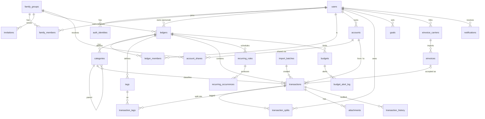

# 04 — Database Schema

PostgreSQL 16 (CI, staging, prod). Required extensions: `pg_trgm`, `pg_stat_statements`, `citext`. Local development runs the same schema on SQLite with the substitutions listed in [01 § 2.1](01-architecture.md#21-sqlite-in-development). The DDL below is the PostgreSQL reference.

## 1. Conventions

| Rule | Detail |
|------|--------|
| Primary keys | `uuid`, generated in the application as **UUIDv7** (time-ordered, which gives good B-tree locality). Generated with the Python 3.14 standard library `uuid.uuid7()`. |
| Money | `bigint` **minor units** (ISO 4217 exponent; TWD = 2) plus `char(3)` currency code. **Never** `float`/`numeric` for stored amounts. `amount_minor` is always **positive**; the sign comes from `type`. |
| FX rates | `numeric(18,8)` |
| Timestamps | `timestamptz`, stored in UTC. A business date that the user sees (e.g. "spent on 2026-11-17") is stored separately as `date` in the user's time zone (`occurred_on`). |
| Enumerations | `text` + `CHECK (col IN (...))`. This avoids PostgreSQL `ENUM` migration pain. Python `StrEnum` mirrors each check. |
| Soft delete | `deleted_at timestamptz NULL` on user-facing financial rows. Hot-path indexes are **partial** `WHERE deleted_at IS NULL`. |
| Archive | `archived_at` for accounts, categories, and ledgers. They are hidden from pickers but kept for history. |
| Concurrency | `version int NOT NULL DEFAULT 1` on rows edited by multiple people (optimistic locking). |
| Naming | snake_case, plural table names, `<table>_<cols>_idx`, `<table>_<rule>_chk`. |
| Foreign keys | Always indexed on the referencing side (unless the column is the leading column of the PK or another index). |

## 2. Entity-relationship diagram



## 3. Tables

### 3.1 Identity & family

```sql
CREATE TABLE users (
    id                     uuid PRIMARY KEY,
    display_name           text        NOT NULL CHECK (length(display_name) BETWEEN 1 AND 60),
    email                  citext      NULL,
    locale                 text        NOT NULL DEFAULT 'zh-TW' CHECK (locale IN ('zh-TW','en')),
    time_zone              text        NOT NULL DEFAULT 'Asia/Taipei',
    default_currency       char(3)     NOT NULL DEFAULT 'TWD',
    week_start             smallint    NOT NULL DEFAULT 1 CHECK (week_start BETWEEN 1 AND 7),   -- ISO weekday
    month_start_day        smallint    NOT NULL DEFAULT 1 CHECK (month_start_day BETWEEN 1 AND 28),
    reminder_time          time        NULL,                                                    -- ST-4
    theme                  text        NOT NULL DEFAULT 'system' CHECK (theme IN ('system','light','dark')),
    analytics_opt_out      boolean     NOT NULL DEFAULT false,
    created_at             timestamptz NOT NULL DEFAULT now(),
    onboarded_at           timestamptz NULL,                                                    -- ON-4
    deletion_requested_at  timestamptz NULL                                                     -- DM-5
);
CREATE INDEX users_deletion_idx ON users (deletion_requested_at) WHERE deletion_requested_at IS NOT NULL;
CREATE INDEX users_reminder_idx ON users (reminder_time) WHERE reminder_time IS NOT NULL;

CREATE TABLE auth_identities (
    id          uuid PRIMARY KEY,
    user_id     uuid        NOT NULL REFERENCES users(id) ON DELETE CASCADE,
    issuer      text        NOT NULL,        -- OIDC "iss"
    subject     text        NOT NULL,        -- OIDC "sub"
    provider    text        NULL,            -- upstream IdP hint from broker: google / apple / line / email
    created_at  timestamptz NOT NULL DEFAULT now(),
    last_login_at timestamptz NULL,
    CONSTRAINT auth_identities_issuer_subject_key UNIQUE (issuer, subject)
);
CREATE INDEX auth_identities_user_idx ON auth_identities (user_id);

CREATE TABLE family_groups (
    id             uuid PRIMARY KEY,
    name           text        NOT NULL CHECK (length(name) BETWEEN 1 AND 60),
    owner_user_id  uuid        NOT NULL REFERENCES users(id),
    plan           text        NOT NULL DEFAULT 'free' CHECK (plan IN ('free','family_plus')),
    max_members    smallint    NOT NULL DEFAULT 2,
    created_at     timestamptz NOT NULL DEFAULT now()
);
CREATE INDEX family_groups_owner_idx ON family_groups (owner_user_id);

CREATE TABLE family_members (
    group_id   uuid        NOT NULL REFERENCES family_groups(id) ON DELETE CASCADE,
    user_id    uuid        NOT NULL REFERENCES users(id) ON DELETE CASCADE,
    role       text        NOT NULL CHECK (role IN ('owner','member','viewer')),
    joined_at  timestamptz NOT NULL DEFAULT now(),
    PRIMARY KEY (group_id, user_id)
);
-- v1 rule: a user belongs to at most one family group (also serves as the user_id lookup index)
CREATE UNIQUE INDEX family_members_one_group_per_user ON family_members (user_id);

CREATE TABLE invitations (
    id           uuid PRIMARY KEY,
    group_id     uuid        NOT NULL REFERENCES family_groups(id) ON DELETE CASCADE,
    token_hash   bytea       NOT NULL UNIQUE,          -- SHA-256 of the random token in the link / QR
    role         text        NOT NULL CHECK (role IN ('member','viewer')),
    invited_by   uuid        NOT NULL REFERENCES users(id),
    expires_at   timestamptz NOT NULL,
    accepted_by  uuid        NULL REFERENCES users(id),
    accepted_at  timestamptz NULL,
    revoked_at   timestamptz NULL,
    created_at   timestamptz NOT NULL DEFAULT now()
);
CREATE INDEX invitations_group_open_idx ON invitations (group_id)
    WHERE accepted_at IS NULL AND revoked_at IS NULL;
```

### 3.2 Ledgers, accounts, categories, tags

```sql
CREATE TABLE ledgers (
    id                    uuid PRIMARY KEY,
    kind                  text        NOT NULL CHECK (kind IN ('personal','shared')),
    owner_user_id         uuid        NULL REFERENCES users(id) ON DELETE CASCADE,       -- personal
    group_id              uuid        NULL REFERENCES family_groups(id) ON DELETE CASCADE, -- shared
    name                  text        NOT NULL CHECK (length(name) BETWEEN 1 AND 60),
    currency              char(3)     NOT NULL,
    default_split_method  text        NOT NULL DEFAULT 'equal'
                                      CHECK (default_split_method IN ('equal','percentage','exact','shares')),
    allow_edit_others     boolean     NOT NULL DEFAULT true,  -- members may edit entries created by others
    revision              bigint      NOT NULL DEFAULT 0,     -- bumped on every write in this ledger (cache key)
    created_at            timestamptz NOT NULL DEFAULT now(),
    archived_at           timestamptz NULL,
    CONSTRAINT ledgers_owner_chk CHECK (
        (kind = 'personal' AND owner_user_id IS NOT NULL AND group_id IS NULL) OR
        (kind = 'shared'   AND group_id IS NOT NULL AND owner_user_id IS NULL))
);
CREATE UNIQUE INDEX ledgers_one_personal_per_user ON ledgers (owner_user_id) WHERE kind = 'personal';
CREATE INDEX ledgers_group_idx ON ledgers (group_id) WHERE group_id IS NOT NULL;

CREATE TABLE ledger_members (                -- who may see / write a shared ledger (subset of the group)
    ledger_id      uuid     NOT NULL REFERENCES ledgers(id) ON DELETE CASCADE,
    user_id        uuid     NOT NULL REFERENCES users(id) ON DELETE CASCADE,
    can_write      boolean  NOT NULL DEFAULT true,           -- false for viewers
    default_weight numeric(9,4) NULL,                        -- default % or shares for non-equal split
    PRIMARY KEY (ledger_id, user_id)
);
CREATE INDEX ledger_members_user_idx ON ledger_members (user_id);

CREATE TABLE accounts (
    id                     uuid PRIMARY KEY,
    owner_user_id          uuid        NOT NULL REFERENCES users(id) ON DELETE CASCADE,
    name                   text        NOT NULL CHECK (length(name) BETWEEN 1 AND 60),
    type                   text        NOT NULL CHECK (type IN
                               ('cash','bank','credit_card','e_wallet','investment','loan')),
    currency               char(3)     NOT NULL,
    opening_balance_minor  bigint      NOT NULL DEFAULT 0,   -- signed; liabilities negative
    credit_limit_minor     bigint      NULL,
    statement_day          smallint    NULL CHECK (statement_day BETWEEN 1 AND 31),
    due_day                smallint    NULL CHECK (due_day BETWEEN 1 AND 31),
    include_in_net_worth   boolean     NOT NULL DEFAULT true,
    sort_order             int         NOT NULL DEFAULT 0,
    created_at             timestamptz NOT NULL DEFAULT now(),
    archived_at            timestamptz NULL,
    version                int         NOT NULL DEFAULT 1
);
CREATE INDEX accounts_owner_idx ON accounts (owner_user_id, sort_order) WHERE archived_at IS NULL;

CREATE TABLE account_shares (                -- AC-5 (P1)
    account_id  uuid    NOT NULL REFERENCES accounts(id) ON DELETE CASCADE,
    group_id    uuid    NOT NULL REFERENCES family_groups(id) ON DELETE CASCADE,
    permission  text    NOT NULL CHECK (permission IN ('read','write')),
    PRIMARY KEY (account_id, group_id)
);
CREATE INDEX account_shares_group_idx ON account_shares (group_id);

CREATE TABLE categories (
    id          uuid PRIMARY KEY,
    ledger_id   uuid        NOT NULL REFERENCES ledgers(id) ON DELETE CASCADE,
    parent_id   uuid        NULL REFERENCES categories(id),
    kind        text        NOT NULL CHECK (kind IN ('expense','income')),
    name        text        NOT NULL CHECK (length(name) BETWEEN 1 AND 40),
    slug        text        NULL,            -- stable key for system defaults, e.g. 'food.lunch'
    icon        text        NOT NULL DEFAULT '📁',
    color       char(7)     NOT NULL DEFAULT '#888888',
    sort_order  int         NOT NULL DEFAULT 0,
    archived_at timestamptz NULL,
    CONSTRAINT categories_name_key UNIQUE NULLS NOT DISTINCT (ledger_id, parent_id, name)
);
CREATE INDEX categories_ledger_idx ON categories (ledger_id, kind, sort_order) WHERE archived_at IS NULL;
CREATE INDEX categories_parent_idx ON categories (parent_id) WHERE parent_id IS NOT NULL;
CREATE UNIQUE INDEX categories_slug_key ON categories (ledger_id, slug) WHERE slug IS NOT NULL;

CREATE TABLE tags (
    id         uuid PRIMARY KEY,
    ledger_id  uuid NOT NULL REFERENCES ledgers(id) ON DELETE CASCADE,
    name       text NOT NULL CHECK (length(name) BETWEEN 1 AND 30),
    CONSTRAINT tags_name_key UNIQUE (ledger_id, name)
);
```

Category depth is limited to two levels. The domain enforces this: a category whose `parent_id` is set may not itself be a parent.

### 3.3 Transactions

```sql
CREATE TABLE import_batches (                -- DM-4: lets a user undo a CSV import as a unit
    id          uuid PRIMARY KEY,
    user_id     uuid        NOT NULL REFERENCES users(id) ON DELETE CASCADE,
    ledger_id   uuid        NOT NULL REFERENCES ledgers(id) ON DELETE CASCADE,
    source      text        NOT NULL,        -- 'csv', 'cwmoney', 'moneybook', ...
    file_key    text        NULL,            -- uploaded file in object storage (large imports run in the worker)
    status      text        NOT NULL DEFAULT 'pending' CHECK (status IN ('pending','running','done','failed')),
    row_count   int         NOT NULL DEFAULT 0,
    error       text        NULL,
    created_at  timestamptz NOT NULL DEFAULT now(),
    undone_at   timestamptz NULL
);

CREATE TABLE transactions (
    id                       uuid PRIMARY KEY,
    ledger_id                uuid        NOT NULL REFERENCES ledgers(id) ON DELETE CASCADE,
    type                     text        NOT NULL CHECK (type IN
                                 ('expense','income','transfer','settlement','adjustment')),
    -- original amount as entered
    amount_minor             bigint      NOT NULL CHECK (amount_minor > 0),
    currency                 char(3)     NOT NULL,
    -- converted amounts (equal to amount_minor when currencies match)
    ledger_amount_minor      bigint      NOT NULL CHECK (ledger_amount_minor > 0),
    account_amount_minor     bigint      NULL,                -- in accounts.currency of account_id
    to_account_amount_minor  bigint      NULL,                -- in accounts.currency of to_account_id
    fx_rate                  numeric(18,8) NULL,              -- original → ledger currency; NULL if same
    adjustment_sign          smallint    NULL CHECK (adjustment_sign IN (-1, 1)),
    occurred_at              timestamptz NOT NULL,
    occurred_on              date        NOT NULL,            -- local business date; grouping key
    account_id               uuid        NULL REFERENCES accounts(id),
    to_account_id            uuid        NULL REFERENCES accounts(id),
    category_id              uuid        NULL REFERENCES categories(id),
    payer_user_id            uuid        NOT NULL REFERENCES users(id),
    counterparty_user_id     uuid        NULL REFERENCES users(id),   -- settlement receiver
    split_method             text        NULL CHECK (split_method IN ('equal','percentage','exact','shares')),
    note                     text        NULL CHECK (length(note) <= 500),
    merchant                 text        NULL CHECK (length(merchant) <= 120),
    source                   text        NOT NULL DEFAULT 'manual'
                                         CHECK (source IN ('manual','recurring','einvoice','import','system')),
    recurring_rule_id        uuid        NULL,                -- FK added after recurring_rules
    import_batch_id          uuid        NULL REFERENCES import_batches(id) ON DELETE SET NULL,
    created_by               uuid        NOT NULL REFERENCES users(id),
    created_at               timestamptz NOT NULL DEFAULT now(),
    updated_at               timestamptz NOT NULL DEFAULT now(),
    deleted_at               timestamptz NULL,
    version                  int         NOT NULL DEFAULT 1,

    CONSTRAINT transactions_shape_chk CHECK (
        (type IN ('expense','income') AND category_id IS NOT NULL AND to_account_id IS NULL
                                       AND counterparty_user_id IS NULL) OR
        (type = 'transfer'   AND account_id IS NOT NULL AND to_account_id IS NOT NULL
                             AND account_id <> to_account_id AND category_id IS NULL) OR
        (type = 'settlement' AND counterparty_user_id IS NOT NULL
                             AND counterparty_user_id <> payer_user_id AND category_id IS NULL) OR
        (type = 'adjustment' AND account_id IS NOT NULL AND adjustment_sign IS NOT NULL
                             AND category_id IS NULL)),
    CONSTRAINT transactions_account_amount_chk CHECK (
        (account_id IS NULL) = (account_amount_minor IS NULL)),
    CONSTRAINT transactions_to_account_amount_chk CHECK (
        (to_account_id IS NULL) = (to_account_amount_minor IS NULL))
);

CREATE TABLE transaction_splits (           -- only for shared-ledger expense / settlement
    transaction_id  uuid    NOT NULL REFERENCES transactions(id) ON DELETE CASCADE,
    user_id         uuid    NOT NULL REFERENCES users(id),
    share_minor     bigint  NOT NULL CHECK (share_minor >= 0),   -- in ledger currency
    share_input     numeric(9,4) NULL,                           -- % or shares as entered
    PRIMARY KEY (transaction_id, user_id)
);
CREATE INDEX transaction_splits_user_idx ON transaction_splits (user_id);

CREATE TABLE transaction_tags (
    transaction_id uuid NOT NULL REFERENCES transactions(id) ON DELETE CASCADE,
    tag_id         uuid NOT NULL REFERENCES tags(id) ON DELETE CASCADE,
    PRIMARY KEY (transaction_id, tag_id)
);
CREATE INDEX transaction_tags_tag_idx ON transaction_tags (tag_id);

CREATE TABLE attachments (
    id              uuid PRIMARY KEY,
    transaction_id  uuid        NOT NULL REFERENCES transactions(id) ON DELETE CASCADE,
    storage_key     text        NOT NULL UNIQUE,
    content_type    text        NOT NULL,
    size_bytes      int         NOT NULL CHECK (size_bytes BETWEEN 1 AND 10485760),
    created_by      uuid        NOT NULL REFERENCES users(id),
    created_at      timestamptz NOT NULL DEFAULT now()
);
CREATE INDEX attachments_tx_idx ON attachments (transaction_id);

CREATE TABLE transaction_history (          -- FM-10 edit history / audit
    id              bigint GENERATED ALWAYS AS IDENTITY PRIMARY KEY,
    transaction_id  uuid        NOT NULL REFERENCES transactions(id) ON DELETE CASCADE,
    changed_by      uuid        NOT NULL REFERENCES users(id),
    changed_at      timestamptz NOT NULL DEFAULT now(),
    action          text        NOT NULL CHECK (action IN ('create','update','delete','restore','move')),
    diff            jsonb       NOT NULL       -- {"field": [old, new], ...}
);
CREATE INDEX transaction_history_tx_idx ON transaction_history (transaction_id, changed_at DESC);
```

#### Transaction indexes (hot paths)

```sql
-- List / keyset pagination / monthly totals per ledger
CREATE INDEX transactions_ledger_date_idx
    ON transactions (ledger_id, occurred_on DESC, id DESC)
    WHERE deleted_at IS NULL;

-- Category reports (covering: no heap access for SUM)
CREATE INDEX transactions_ledger_cat_date_idx
    ON transactions (ledger_id, category_id, occurred_on)
    INCLUDE (ledger_amount_minor, type)
    WHERE deleted_at IS NULL AND type IN ('expense','income');

-- Account balances (outflow side and inflow side)
CREATE INDEX transactions_account_idx
    ON transactions (account_id)
    INCLUDE (type, account_amount_minor, adjustment_sign)
    WHERE deleted_at IS NULL AND account_id IS NOT NULL;
CREATE INDEX transactions_to_account_idx
    ON transactions (to_account_id)
    INCLUDE (to_account_amount_minor)
    WHERE deleted_at IS NULL AND to_account_id IS NOT NULL;

-- Family balances (who paid)
CREATE INDEX transactions_ledger_payer_idx
    ON transactions (ledger_id, payer_user_id)
    INCLUDE (ledger_amount_minor)
    WHERE deleted_at IS NULL AND type IN ('expense','settlement');

-- Recent categories for quick add (per creator)
CREATE INDEX transactions_creator_recent_idx
    ON transactions (created_by, created_at DESC)
    INCLUDE (category_id, ledger_id)
    WHERE deleted_at IS NULL;

-- Trash view and purge
CREATE INDEX transactions_deleted_idx
    ON transactions (ledger_id, deleted_at)
    WHERE deleted_at IS NOT NULL;

-- Text search (TX-12) on note and merchant
CREATE INDEX transactions_search_trgm_idx
    ON transactions USING gin ((coalesce(note,'') || ' ' || coalesce(merchant,'')) gin_trgm_ops)
    WHERE deleted_at IS NULL;

-- FK-only lookups
CREATE INDEX transactions_recurring_idx ON transactions (recurring_rule_id) WHERE recurring_rule_id IS NOT NULL;
CREATE INDEX transactions_import_idx    ON transactions (import_batch_id)   WHERE import_batch_id IS NOT NULL;
CREATE INDEX transactions_category_idx  ON transactions (category_id)       WHERE category_id IS NOT NULL;
```

### 3.4 Recurring, budgets, goals

```sql
CREATE TABLE recurring_rules (
    id                uuid PRIMARY KEY,
    ledger_id         uuid        NOT NULL REFERENCES ledgers(id) ON DELETE CASCADE,
    created_by        uuid        NOT NULL REFERENCES users(id),
    rrule             text        NOT NULL,          -- RFC 5545, e.g. 'FREQ=MONTHLY;BYMONTHDAY=5'
    dtstart           date        NOT NULL,
    until             date        NULL,
    next_run_on       date        NULL,              -- NULL when finished
    mode              text        NOT NULL CHECK (mode IN ('auto','remind')),
    template          jsonb       NOT NULL,          -- type, amount_minor, currency, account_id, category_id,
                                                     -- payer_user_id, split spec, note, tags
    active            boolean     NOT NULL DEFAULT true,
    version           int         NOT NULL DEFAULT 1,
    created_at        timestamptz NOT NULL DEFAULT now()
);
CREATE INDEX recurring_rules_due_idx ON recurring_rules (next_run_on) WHERE active AND next_run_on IS NOT NULL;
CREATE INDEX recurring_rules_ledger_idx ON recurring_rules (ledger_id);

ALTER TABLE transactions
    ADD CONSTRAINT transactions_recurring_fk
    FOREIGN KEY (recurring_rule_id) REFERENCES recurring_rules(id) ON DELETE SET NULL;

CREATE TABLE recurring_occurrences (        -- idempotency for the worker
    rule_id          uuid NOT NULL REFERENCES recurring_rules(id) ON DELETE CASCADE,
    occurrence_date  date NOT NULL,
    transaction_id   uuid NULL REFERENCES transactions(id) ON DELETE SET NULL,  -- NULL for 'remind'
    created_at       timestamptz NOT NULL DEFAULT now(),
    PRIMARY KEY (rule_id, occurrence_date)
);

CREATE TABLE budgets (
    id               uuid PRIMARY KEY,
    ledger_id        uuid        NOT NULL REFERENCES ledgers(id) ON DELETE CASCADE,
    category_id      uuid        NULL REFERENCES categories(id) ON DELETE CASCADE,  -- NULL = ledger total
    amount_minor     bigint      NOT NULL CHECK (amount_minor > 0),
    period           text        NOT NULL DEFAULT 'monthly' CHECK (period IN ('monthly','weekly','custom')),
    rollover         boolean     NOT NULL DEFAULT false,
    alert_thresholds smallint[]  NOT NULL DEFAULT '{80,100}',
    effective_from   date        NOT NULL,
    effective_to     date        NULL,
    version          int         NOT NULL DEFAULT 1,
    CONSTRAINT budgets_scope_key UNIQUE NULLS NOT DISTINCT (ledger_id, category_id, effective_from)
);
CREATE INDEX budgets_ledger_idx ON budgets (ledger_id, effective_from DESC);

CREATE TABLE budget_alert_log (
    budget_id     uuid        NOT NULL REFERENCES budgets(id) ON DELETE CASCADE,
    period_start  date        NOT NULL,
    threshold     smallint    NOT NULL,
    sent_at       timestamptz NOT NULL DEFAULT now(),
    PRIMARY KEY (budget_id, period_start, threshold)
);

CREATE TABLE goals (                        -- BG-4 (P1)
    id              uuid PRIMARY KEY,
    owner_user_id   uuid        NOT NULL REFERENCES users(id) ON DELETE CASCADE,
    ledger_id       uuid        NULL REFERENCES ledgers(id) ON DELETE SET NULL,   -- shared goal if shared ledger
    account_id      uuid        NULL REFERENCES accounts(id) ON DELETE SET NULL,
    name            text        NOT NULL,
    target_minor    bigint      NOT NULL CHECK (target_minor > 0),
    currency        char(3)     NOT NULL,
    deadline        date        NULL,
    achieved_at     timestamptz NULL,
    created_at      timestamptz NOT NULL DEFAULT now()
);
CREATE INDEX goals_owner_idx ON goals (owner_user_id);
```

### 3.5 E-invoice, FX, notifications, outbox, preferences

```sql
CREATE TABLE einvoice_carriers (            -- TX-8 (P1)
    id                    uuid PRIMARY KEY,
    user_id               uuid        NOT NULL REFERENCES users(id) ON DELETE CASCADE,
    carrier_code          text        NOT NULL,       -- '/ABC+123'
    verification_enc      bytea       NOT NULL,       -- Fernet-encrypted verification code
    status                text        NOT NULL DEFAULT 'active' CHECK (status IN ('active','invalid','paused')),
    default_ledger_id     uuid        NULL REFERENCES ledgers(id) ON DELETE SET NULL,
    default_account_id    uuid        NULL REFERENCES accounts(id) ON DELETE SET NULL,
    last_synced_at        timestamptz NULL,
    next_sync_at          timestamptz NOT NULL DEFAULT now(),
    CONSTRAINT einvoice_carriers_key UNIQUE (user_id, carrier_code)
);
CREATE INDEX einvoice_carriers_due_idx ON einvoice_carriers (next_sync_at) WHERE status = 'active';

CREATE TABLE einvoices (
    id              uuid PRIMARY KEY,
    carrier_id      uuid        NOT NULL REFERENCES einvoice_carriers(id) ON DELETE CASCADE,
    invoice_number  text        NOT NULL,          -- e.g. 'AB12345678'
    invoice_date    date        NOT NULL,
    seller_name     text        NULL,
    seller_ban      text        NULL,              -- seller business administration number
    amount_minor    bigint      NOT NULL,
    currency        char(3)     NOT NULL DEFAULT 'TWD',
    items           jsonb       NOT NULL DEFAULT '[]',
    suggested_category_slug text NULL,
    status          text        NOT NULL DEFAULT 'pending' CHECK (status IN ('pending','accepted','ignored')),
    transaction_id  uuid        NULL REFERENCES transactions(id) ON DELETE SET NULL,
    fetched_at      timestamptz NOT NULL DEFAULT now(),
    CONSTRAINT einvoices_number_key UNIQUE (carrier_id, invoice_number)
);
CREATE INDEX einvoices_inbox_idx ON einvoices (carrier_id, invoice_date DESC) WHERE status = 'pending';

CREATE TABLE fx_rates (
    base       char(3)       NOT NULL,
    quote      char(3)       NOT NULL,
    rate_date  date          NOT NULL,
    rate       numeric(18,8) NOT NULL CHECK (rate > 0),
    source     text          NOT NULL,
    PRIMARY KEY (base, quote, rate_date)
);

CREATE TABLE notifications (
    id          uuid PRIMARY KEY,
    user_id     uuid        NOT NULL REFERENCES users(id) ON DELETE CASCADE,
    kind        text        NOT NULL,      -- 'shared_tx_added','shared_tx_changed','settlement','invite_accepted',
                                           -- 'budget_threshold','recurring_due','card_due','einvoice_new',
                                           -- 'monthly_summary','logging_reminder','goal_achieved'
    dedupe_key  text        NULL,          -- e.g. 'monthly_summary:2026-11'
    payload     jsonb       NOT NULL,
    created_at  timestamptz NOT NULL DEFAULT now(),
    read_at     timestamptz NULL,
    emailed_at  timestamptz NULL
);
CREATE INDEX notifications_unread_idx ON notifications (user_id, created_at DESC) WHERE read_at IS NULL;
CREATE INDEX notifications_user_idx   ON notifications (user_id, created_at DESC);
CREATE UNIQUE INDEX notifications_dedupe_key ON notifications (user_id, dedupe_key) WHERE dedupe_key IS NOT NULL;

CREATE TABLE user_notification_settings (
    user_id   uuid    NOT NULL REFERENCES users(id) ON DELETE CASCADE,
    kind      text    NOT NULL,
    in_app    boolean NOT NULL DEFAULT true,
    email     boolean NOT NULL DEFAULT false,
    PRIMARY KEY (user_id, kind)
);

CREATE TABLE outbox_events (
    id             bigint GENERATED ALWAYS AS IDENTITY PRIMARY KEY,
    event_type     text        NOT NULL,
    aggregate_id   uuid        NOT NULL,
    payload        jsonb       NOT NULL,
    occurred_at    timestamptz NOT NULL DEFAULT now(),
    dispatched_at  timestamptz NULL,
    attempts       smallint    NOT NULL DEFAULT 0,
    last_error     text        NULL
);
CREATE INDEX outbox_pending_idx ON outbox_events (id) WHERE dispatched_at IS NULL;

CREATE TABLE quick_add_preferences (       -- FM-4: remember ledger per category
    user_id        uuid NOT NULL REFERENCES users(id) ON DELETE CASCADE,
    category_slug  text NOT NULL,          -- slug, or 'id:<uuid>' for custom categories
    ledger_id      uuid NOT NULL REFERENCES ledgers(id) ON DELETE CASCADE,
    updated_at     timestamptz NOT NULL DEFAULT now(),
    PRIMARY KEY (user_id, category_slug)
);
```

## 4. Derived values (never stored)

| Value | Formula | Query location |
|-------|---------|----------------|
| Account balance | `opening_balance_minor − Σ account_amount_minor (expense, transfer-out, settlement-out, adjustment −1) + Σ account_amount_minor (income, adjustment +1) + Σ to_account_amount_minor (transfer-in, settlement-in)` | `AccountQueries.list_with_balances` — one statement for all accounts |
| Member net balance in a shared ledger | `Σ ledger_amount_minor where payer = member (expense, settlement) − Σ share_minor where split.user = member (expense, settlement)` | `FamilyQueries.balances` — one statement |
| Monthly spend per category | `Σ ledger_amount_minor GROUP BY category_id` over `occurred_on` range | `ReportQueries` — covering index |
| Budget progress | spend in period (incl. subcategories) ÷ budget (+ rollover carry) | `BudgetQueries.progress` — one statement for all budgets |

Positive member net = the member is **owed** money. Recording a settlement (debtor pays creditor X) is a `settlement` transaction with `payer_user_id = debtor`, `counterparty_user_id = creditor`, and one split row `(creditor, X)`. The same formula then moves both nets toward zero, so balances need no special case.

Balances are not cached in a table: with the covering indexes above they are computed in a few ms for ledgers up to ~100 k transactions. A materialized summary is an explicit later optimization, triggered by a metric (see [06 § 8](06-query-performance.md#8-scaling-triggers)).

## 5. Integrity rules enforced in the domain (not expressible as simple CHECKs)

1. A shared-ledger `expense` must have splits whose `share_minor` values sum **exactly** to `ledger_amount_minor`. A personal-ledger transaction must have **no** splits.
2. Every split user and `payer_user_id` in a shared ledger must be a `ledger_members` row.
3. `account_id` must belong to `payer_user_id` (or be shared to the group with `write`).
4. `category_id` must belong to the same `ledger_id` and match `kind` (expense ↔ expense).
5. Category depth ≤ 2.
6. Viewers (`can_write = false`) cannot create or edit transactions.

These are also covered by integration tests that try to bypass them through the repository.

## 6. Migrations & data lifecycle

- Alembic, one revision per PR, linear history. Each revision must be **reversible** (`downgrade` implemented) and **online-safe**: `CREATE INDEX CONCURRENTLY` in its own non-transactional revision; new `NOT NULL` columns are added in three steps (add nullable → backfill in batches → add constraint `NOT VALID` then `VALIDATE`).
- Seed data (default categories, currency exponents) lives in versioned Python modules, not in migrations, and is applied by the `SignInUser` / `CreateSharedLedger` use cases.
- Retention: soft-deleted transactions are purged after 30 days. `transaction_history` is kept for the lifetime of the transaction. `outbox_events` older than 14 days with `dispatched_at` set are deleted. Read notifications are deleted after 180 days.
- Backups: managed PITR (7 days) and daily logical dump (30-day retention). A restore drill runs quarterly.
